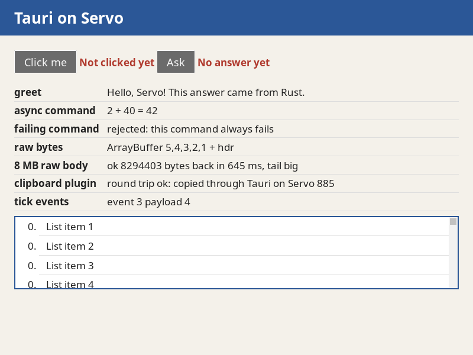
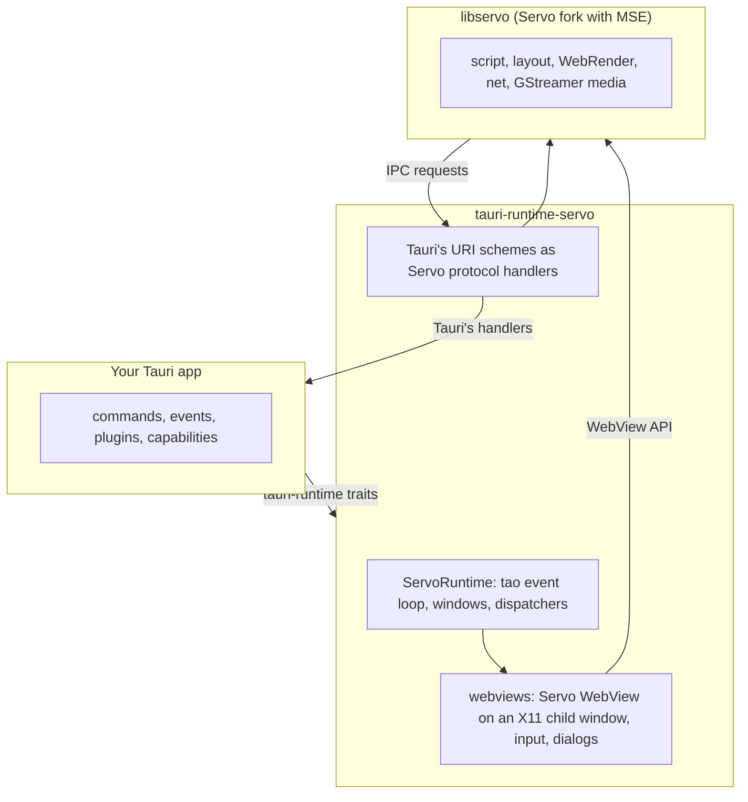

# tauri-runtime-servo

**A Tauri runtime that draws your app's windows with the Servo web engine instead of the system webview.**

Tauri normally shows pages through [wry](https://github.com/tauri-apps/wry), which on Linux means WebKitGTK. This crate implements the same `tauri-runtime` traits with a [Servo](https://servo.org) `WebView` in each window. Your commands, events, plugins and permissions stay as they are.

It was written for [VODscribe](https://github.com/Airodonack/VODscribe), a desktop app that plays video sites' players with Media Source Extensions on the same engine on every Linux system.





## Status

Version 0.1.0. Linux under X11 only, tested on a desktop and headless under Xvfb.

Works: windows and menus through tao, several windows, child webviews; Tauri's IPC (commands, events, plugins, capabilities); pages on `tauri://localhost` and on a `devUrl`; initialization scripts, `eval`, load events, navigation policy; `alert()`, `confirm()` and `prompt()` as GTK dialogs; storage and cookies in the app's data folder; Media Source Extensions; end-to-end tests over WebDriver.

Not yet: Wayland, macOS and Windows; devtools; printing; the cookie API; `<select>`, colour and file pickers; context menus; `window.open`; drag and drop; cursor shapes. Keys go to a window's first webview only. Webview attributes other than the URL, initialization scripts, `data_directory`, `focus`, `bounds` and `auto_resize` are ignored.

Next, roughly in order: pickers and context menus, the cookie API, Wayland, devtools, then macOS and Windows.

## Requirements

| | |
|---|---|
| Linux, X11 | GTK 3 windows (tao 0.37). Under Wayland, set `GDK_BACKEND=x11`. |
| Rust 1.99.1 | The Servo fork's toolchain, in `rust-toolchain.toml`. |
| Tauri 2.12 | `tauri` 2.12.3, `tauri-runtime` =2.12.1, `tauri-utils` =2.10.2. The runtime traits are not semver-stable, so the pins are exact. |
| libservo | The [Airodonack/servo](https://github.com/Airodonack/servo) fork, branch `vodscribe/main`, a git dependency pinned by revision. |
| Stylo | Branch `vodscribe/main` of [Airodonack/stylo](https://github.com/Airodonack/stylo), a git dependency every app patches in (below). |
| GStreamer | 1.26 or newer to build, 1.28 to run. Ubuntu 26.04 has 1.28. |
| Packages | X11, EGL, GTK 3 and WebKitGTK 4.1 development files; see [check.yml](.github/workflows/check.yml). |

## Quick start

```sh
git clone https://github.com/Airodonack/tauri-runtime-servo
cd tauri-runtime-servo
export CC=clang CXX=clang++   # mozjs is built with clang
cargo run --release -p helloworld
```

The first build compiles Servo and takes tens of minutes and tens of gigabytes. A window titled "Hello from Servo" opens and prints a `RESULT` line for each IPC check. See the [example](examples/helloworld/README.md).

## Using it in a Tauri app

**1. Dependencies.** Turn off `tauri`'s default features, which pull in wry, and add the runtime:

```toml
[dependencies]
tauri = { version = "=2.12.3", default-features = false, features = ["compression", "common-controls-v6", "dynamic-acl", "x11", "dbus"] }
tauri-runtime-servo = { git = "https://github.com/Airodonack/tauri-runtime-servo", rev = "<commit>" }
```

**2. The Stylo patch.** The fork needs its own Stylo branch. Cargo applies `[patch]` only from the root workspace, so add this to your app's root `Cargo.toml`. Patch all eleven crates; patching `stylo` alone builds two copies of the shared ones.

```toml
[patch."https://github.com/servo/stylo"]
selectors = { git = "https://github.com/Airodonack/stylo", rev = "eb9f6ae0500f2415fd9dd224780a55094ef3be18" }
servo_arc = { git = "https://github.com/Airodonack/stylo", rev = "eb9f6ae0500f2415fd9dd224780a55094ef3be18" }
stylo = { git = "https://github.com/Airodonack/stylo", rev = "eb9f6ae0500f2415fd9dd224780a55094ef3be18" }
stylo_atoms = { git = "https://github.com/Airodonack/stylo", rev = "eb9f6ae0500f2415fd9dd224780a55094ef3be18" }
stylo_derive = { git = "https://github.com/Airodonack/stylo", rev = "eb9f6ae0500f2415fd9dd224780a55094ef3be18" }
stylo_dom = { git = "https://github.com/Airodonack/stylo", rev = "eb9f6ae0500f2415fd9dd224780a55094ef3be18" }
stylo_malloc_size_of = { git = "https://github.com/Airodonack/stylo", rev = "eb9f6ae0500f2415fd9dd224780a55094ef3be18" }
stylo_static_prefs = { git = "https://github.com/Airodonack/stylo", rev = "eb9f6ae0500f2415fd9dd224780a55094ef3be18" }
stylo_traits = { git = "https://github.com/Airodonack/stylo", rev = "eb9f6ae0500f2415fd9dd224780a55094ef3be18" }
to_shmem = { git = "https://github.com/Airodonack/stylo", rev = "eb9f6ae0500f2415fd9dd224780a55094ef3be18" }
to_shmem_derive = { git = "https://github.com/Airodonack/stylo", rev = "eb9f6ae0500f2415fd9dd224780a55094ef3be18" }
```

Without it the build fails in `servo-layout` with ``no field `scrollbar_gutter` ``.

To build against a local Servo checkout, patch `https://github.com/Airodonack/servo` the same way: `servo`, `servo-net-traits` and `servo-webdriver-server`, each with the path of its folder under `components/`.

**3. Compiler settings.** mozjs and Servo's script crates use nightly features on stable. Put this in your app's `.cargo/config.toml` and use Rust 1.99.1:

```toml
[env]
RUSTC_BOOTSTRAP = "crown,script,script_webcrypto,script_webgpu,script_bindings,style_tests,mozjs,mozjs_sys"
```

**4. The builder.**

```rust
use tauri_runtime_servo::ServoRuntime;

fn main() {
    tauri::Builder::<ServoRuntime<tauri::EventLoopMessage>>::new()
        .run(tauri::generate_context!())
        .expect("error while running the application");
}
```

`WebviewWindow::with_webview` gives you the `servo::WebView` through `downcast_ref`. The crate re-exports `servo` and `tao`.

### Feature flags and environment

| | |
|---|---|
| `webdriver` feature | Builds in Servo's WebDriver server for end-to-end tests. Test builds only: it runs any script it is sent. |
| `TAURI_RUNTIME_SERVO_WEBDRIVER_PORT` | The port the WebDriver server listens on, on `127.0.0.1`. Unset: no server. |
| `XDG_DATA_HOME` | Where storage and cookies go: `$XDG_DATA_HOME/<identifier>`. One store per process. |
| `RUST_LOG` | The runtime logs under `tauri_runtime_servo`; the page's console under `console` at debug level. |

## Notes on the design

- Tauri's `ipc://`, `tauri://`, `asset://` and plugin schemes become Servo protocol handlers that call Tauri's handlers on the main thread. App pages load as `http://tauri.localhost/` because a custom scheme gets no storage in Servo; Tauri still sees `tauri://localhost`.
- Servo is one instance per process, built at the first webview. Its data directory and protocol list are fixed then.
- Windows are tao windows, so menus and dialogs work as under wry. Servo paints into an X11 child window below the menu bar; the runtime forwards GTK's input to it.
- The window and dispatcher code is adapted from `tauri-runtime-wry` 2.12.1.

## Contributing

Open an issue with the Tauri version, the log with `RUST_LOG=warn,tauri_runtime_servo=debug`, and the smallest page that shows the problem. Before a pull request, run the checks in [check.yml](.github/workflows/check.yml).

## Licence

Apache License 2.0 or MIT, at your option. Copyright Airodonack. Parts are adapted from [tauri-runtime-wry](https://github.com/tauri-apps/tauri/tree/dev/crates/tauri-runtime-wry), Copyright 2019-2024 Tauri Programme within The Commons Conservancy; see [NOTICE](NOTICE).

## Layout

| Path | What it holds |
|---|---|
| [`src/`](src/README.md) | The runtime. |
| [`examples/`](examples/README.md) | `helloworld` checks every IPC surface; `menubar` checks a window with a menu bar. |
| [`docs/`](docs/README.md) | Images for the READMEs. |
| [`.github/workflows/`](.github/workflows/README.md) | CI. |
| [`.cargo/`](.cargo/README.md) | `RUSTC_BOOTSTRAP` for the build. |
| `Cargo.toml`, `Cargo.lock` | The crate, the workspace, the pins and the Stylo patch. |
| `rust-toolchain.toml` | Rust 1.99.1. |
| `CHANGELOG.md` | What changed in each release. |
| `LICENSE-APACHE`, `LICENSE-MIT`, `NOTICE` | Licences and the tauri-runtime-wry copyright. |
