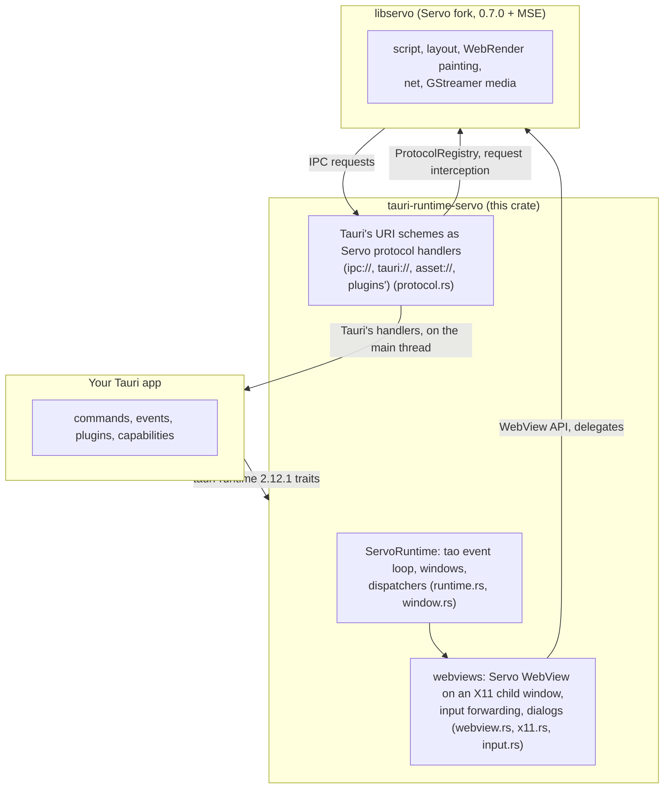

# tauri-runtime-servo

**A drop-in Tauri runtime that draws your app's windows with the Servo web engine instead of the system webview.**

A Tauri app normally shows its pages through [wry](https://github.com/tauri-apps/wry), which on Linux means WebKitGTK. This crate implements the same `tauri-runtime` traits wry's runtime does, but each webview is a [Servo](https://servo.org) `WebView` painting into the window. The app's Rust code, its commands, events, plugins and permissions stay as they are; only the engine under the page changes.

## Why it exists, and who it is for

It was written for [VODscribe](https://github.com/Airodonack/VODscribe), a desktop app whose pages must play video sites' players unmodified, with Media Source Extensions, on a media stack the app controls (Servo's GStreamer backend), the same on every Linux system rather than whichever WebKitGTK the distribution ships. That makes it useful to:

- Tauri app authors on Linux who want one engine, built into the binary, instead of the system's;
- people who embed Servo and want Tauri's window, IPC and plugin machinery around it;
- anyone curious how far Servo gets as a real application's webview.

It is not (yet) a general replacement for wry: see [Status](#status).

## The picture




## Status

Early, and working for the app it was written for: version 0.1.0, run by VODscribe's Servo build. Everything listed as working has been run on Linux under X11, on a desktop and headless under Xvfb; a few unit tests cover the pieces that run without a display.

Works:

- windows and their getters and setters, through tao as with wry on Linux; several windows; child webviews placed by bounds;
- Tauri's IPC: commands (sync, async, failing, raw bytes with headers), events, plugins' JavaScript APIs, capabilities and the ACL;
- the app's own pages on `tauri://localhost` (production builds) and a `devUrl` (development);
- initialization scripts, `eval` with its result as JSON, page load events, navigation policy, title changes;
- `alert()`, `confirm()` and `prompt()` as GTK dialogs;
- the page's storage, cookies and HSTS list kept in the app's local data folder;
- Media Source Extensions (through the Servo fork) and the rest of Servo's web platform;
- end-to-end tests over W3C WebDriver (the `webdriver` feature).

Does not work yet (each returns a `tauri_runtime::Error` or logs a warning):

- Wayland, macOS and Windows (the crate refuses to build off Linux);
- devtools (Servo has no built-in inspector), printing, moving a webview to another window;
- the cookie API (`cookies`, `set_cookie`, `delete_cookie`), clearing browsing data, a webview's background colour;
- `<select>` pickers, colour and file pickers, input methods and context menus (Servo asks for them; nothing is drawn, so the default answer is taken);
- `window.open`, permission prompts (denied), HTTP authentication (cancelled), the page moving or resizing its window;
- wry's `window.ipc.postMessage` fallback (Tauri only uses it when its `ipc://` request fails, which it does not here).

## Requirements and platform support

| | Supported | Notes |
|---|---|---|
| Linux, X11 | yes | GTK 3 windows (tao 0.37); the webview is an X11 child window with an EGL surface |
| Linux, Wayland | not yet | `GDK_BACKEND=x11` runs the app under XWayland |
| macOS, Windows | not yet | `compile_error!` off Linux |
| Rust | 1.97.1 | the toolchain the Servo fork is built with (`rust-toolchain.toml`); `RUSTC_BOOTSTRAP` for mozjs, see below |
| Tauri | 2.12 (`tauri` 2.12.3, `tauri-runtime` =2.12.1, `tauri-utils` =2.10.2) | the runtime traits are not semver-stable, so the pins are exact |
| libservo | the [Airodonack/servo](https://github.com/Airodonack/servo) fork, branch `vodscribe/main` (Servo 0.7.0 + Media Source Extensions) | a path dependency for now, see [Using it](#using-it-in-a-tauri-app) |
| Stylo | 0.22.0 plus the fork's style properties (branch `vodscribe/v0.22.0` of [Airodonack/stylo](https://github.com/Airodonack/stylo), a git dependency) | patched in by every consumer, see below |
| GStreamer | 1.24 or newer to build (`gstreamer-mse-1.0` is in gst-plugins-bad since 1.24); 1.28 recommended to run | media; the X11, EGL and GTK development packages are listed in [.github/workflows/check.yml](.github/workflows/check.yml) |
| WebKitGTK 4.1 development files | build time only | `tauri` and `tauri-runtime` depend on `webkit2gtk` on Linux whatever the runtime; nothing of it is linked into the binary |

## Quick start

The crate builds against a sibling checkout of the Servo fork (the layout below); Stylo comes from its git source, so it needs no checkout. With Rust (rustup), clang, the packages from the table and room for Servo's build (tens of gigabytes):

```sh
mkdir servo-work && cd servo-work
git clone -b vodscribe/main https://github.com/Airodonack/servo servo
mkdir tauri-servo && git clone https://github.com/Airodonack/tauri-runtime-servo tauri-servo/tauri-runtime-servo
cd tauri-servo/tauri-runtime-servo
export CC=clang CXX=clang++   # mozjs is built with clang
cargo run --release -p helloworld
```

The first build compiles Servo and takes a while (tens of minutes on a laptop). A window titled "Hello from Servo" opens; the page and the terminal print `RESULT` lines for each IPC check it makes. The [example's README](examples/helloworld/README.md) says what each line proves and how to run it headless.

## Using it in a Tauri app

**1. The dependencies.** Turn `tauri`'s default features off (they pull in wry) and add the runtime:

```toml
[dependencies]
tauri = { version = "=2.12.3", default-features = false, features = ["compression", "common-controls-v6", "dynamic-acl", "x11", "dbus"] }
tauri-runtime-servo = { path = "../tauri-servo/tauri-runtime-servo" }
```

**2. The Stylo patch.** The fork's layout reads style properties (`scrollbar-width`, `scrollbar-color`, `scrollbar-gutter`, `accent-color`, `text-overflow`) that stock Stylo 0.22.0 leaves out of Servo's style structs, so the build needs the fork's Stylo branch (`vodscribe/v0.22.0` of [Airodonack/stylo](https://github.com/Airodonack/stylo), servo/stylo v0.22.0 plus three commits: the scrollbar properties, `text-overflow` and `accent-color` ungated for Servo, and a UA-only `-servo-accent-color` keyword). Cargo applies `[patch]` only from the workspace a build starts in, never from a dependency, so your app's root `Cargo.toml` needs the same block this repository's has. All eleven crates of Stylo's workspace are patched together: patching `stylo` alone builds two copies of the shared ones, which do not fit together.

```toml
[patch.crates-io]
selectors = { git = "https://github.com/Airodonack/stylo", rev = "b5c009c00c159d11d9c01f4c01957f4b2290b767" }
servo_arc = { git = "https://github.com/Airodonack/stylo", rev = "b5c009c00c159d11d9c01f4c01957f4b2290b767" }
stylo = { git = "https://github.com/Airodonack/stylo", rev = "b5c009c00c159d11d9c01f4c01957f4b2290b767" }
stylo_atoms = { git = "https://github.com/Airodonack/stylo", rev = "b5c009c00c159d11d9c01f4c01957f4b2290b767" }
stylo_derive = { git = "https://github.com/Airodonack/stylo", rev = "b5c009c00c159d11d9c01f4c01957f4b2290b767" }
stylo_dom = { git = "https://github.com/Airodonack/stylo", rev = "b5c009c00c159d11d9c01f4c01957f4b2290b767" }
stylo_malloc_size_of = { git = "https://github.com/Airodonack/stylo", rev = "b5c009c00c159d11d9c01f4c01957f4b2290b767" }
stylo_static_prefs = { git = "https://github.com/Airodonack/stylo", rev = "b5c009c00c159d11d9c01f4c01957f4b2290b767" }
stylo_traits = { git = "https://github.com/Airodonack/stylo", rev = "b5c009c00c159d11d9c01f4c01957f4b2290b767" }
to_shmem = { git = "https://github.com/Airodonack/stylo", rev = "b5c009c00c159d11d9c01f4c01957f4b2290b767" }
to_shmem_derive = { git = "https://github.com/Airodonack/stylo", rev = "b5c009c00c159d11d9c01f4c01957f4b2290b767" }
```

Without it the build stops in `servo-layout` with ``no field `scrollbar_gutter` on type `&style::properties::style_structs::Box` ``.

**3. The compiler settings.** mozjs and Servo's script crates use nightly features on the stable toolchain. Like the fork, put this in your app's `.cargo/config.toml` (Cargo reads it from where the build starts, not from dependencies), and use the fork's toolchain, 1.97.1 (a `rust-toolchain.toml` with `channel = "1.97.1"`):

```toml
[env]
RUSTC_BOOTSTRAP = "crown,script,script_webgpu,script_bindings,style_tests,mozjs,mozjs_sys"
```

**4. The builder.** Name the runtime in the builder's type:

```rust
use tauri_runtime_servo::ServoRuntime;

fn main() {
    tauri::Builder::<ServoRuntime<tauri::EventLoopMessage>>::new()
        .run(tauri::generate_context!())
        .expect("error while running the application");
}
```

`WebviewWindow::with_webview` hands you the `servo::WebView` (`webview.downcast_ref::<servo::WebView>()`), and the crate re-exports `servo` and `tao` so you use the same versions it does.

### Feature flags

| Feature | Default | What it does, and why |
|---|---|---|
| `devtools` | off | Mirrors `tauri-runtime`'s: the devtools methods exist on the trait in debug builds and with it. They do nothing yet (Servo has no inspector window). |
| `webdriver` | off | Builds in Servo's WebDriver server so end-to-end tests drive the app over W3C WebDriver, with no tauri-driver. **Test builds only**: the server listens on the loopback interface only (`127.0.0.1`), so no other machine can reach it, but any program on this one can, and it runs any script it is sent in the app's pages, which can call the app's commands. Never ship it. |

### Environment variables

| Variable | What it does, and why |
|---|---|
| `TAURI_RUNTIME_SERVO_WEBDRIVER_PORT` | With the `webdriver` feature, the port the WebDriver server listens on, on `127.0.0.1`. Unset or empty: no server. Without the feature it only logs an error, so a test setting it against a wrong build says so. |
| `XDG_DATA_HOME` | Where the page's storage, cookies and HSTS list go: Tauri hands every webview its app local data folder (`$XDG_DATA_HOME/<identifier>`, or `~/.local/share/<identifier>`), and Servo keeps one store for the process in the first webview's. Point it at a scratch folder for tests. |
| `RUST_LOG` | The runtime logs through `log` under `tauri_runtime_servo`; the page's console under the target `console`, at debug level (`RUST_LOG=console=debug` to see it): a page's console is no place for an app's log file. |
| `GDK_BACKEND` | `x11` under a Wayland session, so the windows are X11 ones (through XWayland). |

## How it fits Tauri and Servo

- **Tauri** talks to a runtime through the `tauri-runtime` traits (`Runtime`, `RuntimeHandle`, `WindowDispatch`, `WebviewDispatch`). They are marked unstable, so this crate pins `tauri-runtime` and `tauri-utils` exactly and moves with Tauri deliberately, one minor version at a time. The window and dispatcher plumbing is adapted from `tauri-runtime-wry` 2.12.1, so windows behave as they do under wry.
- **Windows** are tao windows (GTK 3), so menus, dialogs' parents and anything a plugin reaches through the GTK window work unchanged. Servo paints into an X11 child window of the toplevel through EGL; the child takes no input, and the runtime forwards GTK's pointer and key events to Servo.
- **IPC** is the part that differs most. Tauri's `ipc://`, `tauri://`, `asset://` and the plugins' schemes become Servo protocol handlers that call Tauri's handlers on the main thread, as WebKitGTK does. The app's pages load as `http://tauri.localhost/` (wry's URL on Windows) and are answered by Tauri's `tauri` handler through Servo's request interception, because a page on a custom scheme gets an opaque origin in Servo (no storage). Tauri still sees `tauri://localhost` everywhere it looks. An app page the runtime cannot hand to Tauri gets an error response; it never goes to the network, where `tauri.localhost` would reach whatever local server listens on port 80.
- **Servo** is one instance for the process, built at the first webview: its protocol registry and data directory are fixed then. It is the Airodonack fork of Servo 0.7.0, which adds Media Source Extensions over GStreamer's mselib; the plan is to follow upstream releases and drop the fork as the work lands upstream.

## Known limitations and roadmap

- One data directory per process: only the first webview's `data_directory` counts (Servo keeps one storage per process).
- A URI scheme first registered after the first webview was made cannot be added (Servo's protocol registry is fixed when it is built); the runtime logs it.
- Keys go to the window's first webview; pointer events to every webview under the pointer.
- libservo is a path dependency on a sibling checkout of the Servo fork; Stylo is a git dependency. Publishing on crates.io waits on libservo being usable from crates.io with the fork's changes, or on git dependencies for the Servo fork too.

Next, roughly in order: the embedder controls (`<select>`, file and colour pickers, context menus), the cookie API, Wayland, devtools through Servo's Firefox-remote server, then macOS and Windows.

## Reporting problems and contributing

Open an issue on [Airodonack/tauri-runtime-servo](https://github.com/Airodonack/tauri-runtime-servo/issues) with the Tauri version, the log with `RUST_LOG=warn,tauri_runtime_servo=debug`, and the smallest page or app that shows it. Bugs in Servo itself belong with [Servo](https://github.com/servo/servo) when they reproduce in servoshell; mention them here too if they block an app. Pull requests are welcome: run the checks in [.github/workflows/check.yml](.github/workflows/check.yml) first (`cargo fmt -p tauri-runtime-servo -p helloworld -- --check`, `cargo clippy --release --workspace --all-targets --all-features -- -D warnings`, `cargo test --release -p tauri-runtime-servo --features devtools`). Never `cargo fmt --all` here: it would reformat the Servo checkout the path dependencies point at.

## Licence and acknowledgements

Licensed under either of [Apache License 2.0](LICENSE-APACHE) or [MIT](LICENSE-MIT), at your option. Copyright Airodonack.

The window, monitor and dispatcher plumbing is adapted from [tauri-runtime-wry](https://github.com/tauri-apps/tauri/tree/dev/crates/tauri-runtime-wry) 2.12.1, Copyright 2019-2024 Tauri Programme within The Commons Conservancy, Apache-2.0 OR MIT; see [NOTICE](NOTICE). The input conversion and the WebDriver command handling follow servoshell's (MPL-2.0). Thanks to the Tauri and Servo projects, whose work this only connects.

## What is in this directory

| Path | What it holds |
|---|---|
| [`src/`](src/README.md) | The runtime's source: event loop, windows, webviews, IPC schemes, input, dialogs, WebDriver. Start there to see how it works. |
| [`examples/`](examples/README.md) | Runnable Tauri apps on this runtime; `helloworld` exercises every IPC surface and prints a `RESULT` line for each. |
| [`docs/`](docs/README.md) | Images the READMEs use (the helloworld screenshot). |
| [`.github/workflows/`](.github/workflows/README.md) | CI: formatting, lints, tests and the example's build on Ubuntu. |
| [`.cargo/`](.cargo/README.md) | Cargo configuration for this workspace (`RUSTC_BOOTSTRAP` for mozjs and Servo's script crates). |
| `Cargo.toml` | The crate and the workspace (with the example), its pinned Tauri and Servo dependencies, the Stylo patch block, the features. |
| `Cargo.lock` | The exact dependency versions the checks ran with. |
| `rust-toolchain.toml` | The Rust toolchain, 1.97.1: the one the Servo fork is built with. |
| `CHANGELOG.md` | What changed in each release, for someone using the crate. |
| `LICENSE-APACHE`, `LICENSE-MIT` | The two licences, at your option. |
| `NOTICE` | The copyright of the tauri-runtime-wry code this crate adapts. |
| `.gitignore` | Keeps build output, scratch files and the example's generated schemas out of git. |
